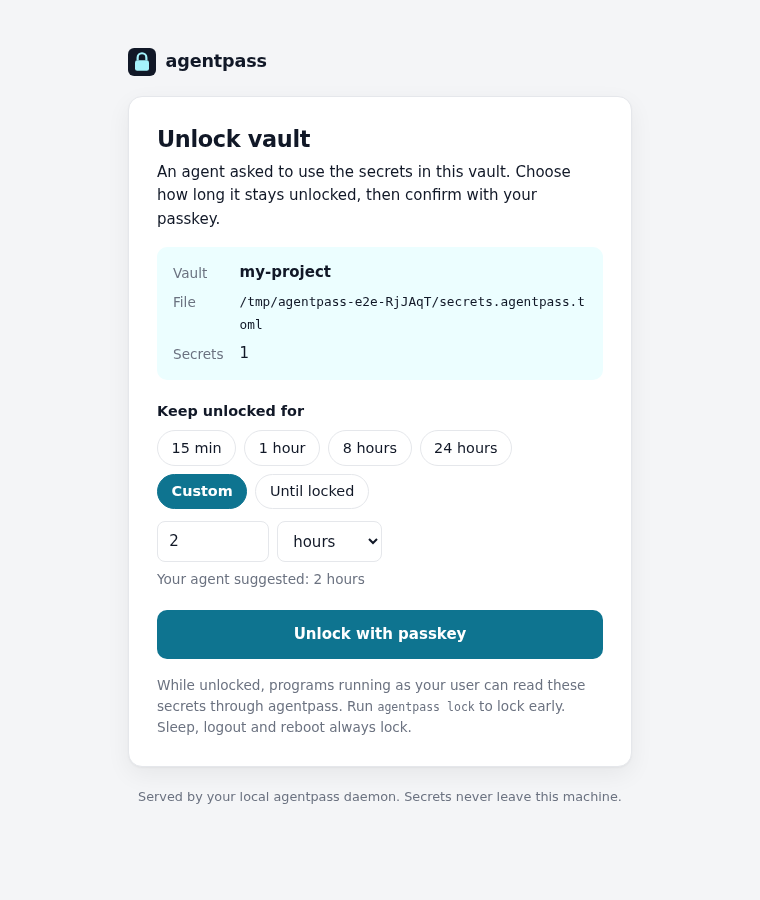

<div align="center">

# 🔐 agentpass

**A password manager for AI agents, unlocked with your passkey.**

Your coding agent gets the API keys it needs, **only when you say so**, without the secrets ever touching disk, logs or its own context.

[](https://github.com/traumventures/agentpass/actions/workflows/ci.yml)
[](https://github.com/traumventures/agentpass/releases)


</div>

```sh
agentpass get GITHUB_TOKEN | gh auth login --with-token   # piped straight into the command
agentpass run -e NPM_TOKEN -- npm publish                 # or passed as an env variable
```

## Install

**Prebuilt binary** (Linux and macOS, x86_64 and arm64):

```sh
curl -fsSL https://raw.githubusercontent.com/traumventures/agentpass/main/install.sh | sh
```

**With Cargo**, from this repository:

```sh
cargo install --locked --git https://github.com/traumventures/agentpass agentpass
```

The web UI is prebuilt and committed, so Cargo needs no extra tools. Release archives with SHA-256 checksums are also on the [releases page](https://github.com/traumventures/agentpass/releases).

## Get started in a minute

```sh
cd my-project
agentpass setup                         # name the vault, register a passkey in the browser
agentpass set GITHUB_TOKEN -d "PAT for CI"   # prompts without echo
git add secrets.agentpass.toml          # safe to commit: values are encrypted
agentpass init-skill                    # teach your coding agent how to use it
```

From then on your agent handles the rest. When it needs a secret and the vault is locked, it runs `agentpass unlock` and shows you a link. You open it, choose how long the vault stays unlocked and touch your passkey:

<p align="center">
  
</p>

## Why agentpass?

Agents need credentials, but the usual options leak them: `.env` files sit in plain text on disk, keys pasted into chat end up in transcripts, and a global keychain unlock gives everything access to everything.

agentpass is built around a few rules:

- 🔑 **Your passkey is the key.** Unlocking needs a WebAuthn passkey with the PRF extension: a YubiKey or other security key, or a passkey in 1Password, Bitwarden, iCloud Keychain or Google Password Manager. There is no master password to leak.
- ⏱️ **You decide how long.** 15 minutes, a few hours, a custom time, or until you lock it. Sleep, logout and reboot always lock it.
- 🧠 **Plaintext only in RAM.** Decrypted keys live in locked, no-dump memory inside a small background daemon. Values are handed out through a pipe or a child process's environment, never through files.
- 📁 **Commit your vault.** `secrets.agentpass.toml` keeps names and descriptions readable for review. Only values are encrypted, so it's safe to commit to git.
- 🤖 **Made for agents.** Clear exit codes, `wait` to block until you've unlocked, and a ready-made skill for Claude Code, Codex, Cursor, Copilot, Gemini CLI and OpenCode.

## Teach your agent

`agentpass init-skill` asks which coding agents you use and whether to install for all your projects or only this one, then writes the skill to the right place:

| Agent | Global | Project |
|---|---|---|
| Claude Code | `~/.claude/skills/` | `.claude/skills/` |
| Codex (and others that read `.agents`) | `~/.agents/skills/` | `.agents/skills/` |
| Cursor | `~/.cursor/skills/` | `.cursor/skills/` |
| GitHub Copilot | `~/.copilot/skills/` | `.github/skills/` |
| Gemini CLI | `~/.gemini/skills/` | `.gemini/skills/` |
| OpenCode | `~/.config/opencode/skills/` | `.opencode/skills/` |

It also runs without prompts: `agentpass init-skill --tool claude --tool codex --project --yes`, or `--all --global`.

Prefer to copy it yourself? The skill is [`skills/agentpass/SKILL.md`](skills/agentpass/SKILL.md), and `agentpass skill` prints it. In short, it tells the agent to:

- never print or capture secret values
- pipe values into commands, or use `agentpass run`
- on exit code `3`, run `agentpass unlock`, show you the link, then run `agentpass wait`
- ask you to run `agentpass set` yourself instead of pasting secrets into the chat

## Commands

| Command | What it does |
|---|---|
| `agentpass setup [--name N] [--label L] [--open]` | Create a vault and register its first passkey |
| `agentpass set KEY [-d DESC]` | Encrypt and store a value from a hidden prompt or stdin (works while locked) |
| `agentpass list [--json]` · `rm KEY` | Show names and descriptions · delete a secret |
| `agentpass unlock [--suggest 1h\|forever] [--open]` | Print an unlock link and return immediately |
| `agentpass wait [--timeout 10m]` | Block until unlocked (`--timeout 0` waits forever) |
| `agentpass get KEY` | Write a value to stdout for piping (refuses a terminal unless `--reveal`) |
| `agentpass run -e KEY -e NAME=KEY -- cmd …` | Run `cmd` with secrets as environment variables |
| `agentpass lock [--all]` | Lock now: the key is wiped from memory |
| `agentpass status [--all] [--json]` | Lock state and time left (exits `3` if locked) |
| `agentpass name [NEW]` | Show or change the vault's name |
| `agentpass passkey add\|list\|remove` | Manage backup passkeys (`add` and `remove` need the vault unlocked) |
| `agentpass skill` · `init-skill` | Print or install the agent skill |

**Exit codes:** `0` ok · `1` error · `2` usage · `3` locked · `4` not found · `5` timeout

## Vault files

A vault is a file named `<something>.agentpass.toml`; `agentpass setup` creates `secrets.agentpass.toml`. agentpass uses the nearest one in the current directory or its parents. If a directory has several, `secrets.agentpass.toml` wins. Select another with `--vault prod` (`prod.agentpass.toml`), a path, or `AGENTPASS_VAULT`.

```toml
version = 1
vault_id = "01K7…"
name = "my-project"
public_key = "base64…"                  # X25519

[[passkeys]]
label = "YubiKey 5C"
credential_id = "base64url…"
prf_salt = "base64url…"
wrapped_private_key = "apw1:…"          # vault key, encrypted with this passkey's PRF output

[secrets.GITHUB_TOKEN]
description = "PAT for CI"
value = "ap1:…"                         # encrypted to public_key
```

`set` encrypts to the public key, so adding a secret never needs your passkey. Enroll a second passkey (`agentpass passkey add`) as a backup.

## How it works

```text
 agent ──▶ agentpass CLI ──Unix socket (0600, same uid)──▶ daemon: vault keys in mlocked RAM
                                                            ▲
 you   ──▶ browser: http://localhost:47117 (Yew) ── WebAuthn PRF ──┘ unwraps the vault key
```

1. **Daemon.** The first `unlock` starts a background daemon (the same binary). It serves the unlock page on `127.0.0.1` and answers the CLI over a private Unix socket.
2. **Unlock.** The page asks your passkey for its **PRF** output, a stable 32-byte secret the authenticator derives from a per-passkey salt. HKDF turns it into a key that unwraps the vault's X25519 private key (XChaCha20-Poly1305). The key must match the vault's public key, so a successful unlock proves the passkey is genuine.
3. **Values.** Each value is sealed to the vault's public key: ephemeral X25519, HKDF-SHA256, then ChaCha20-Poly1305. The vault id and secret name are authenticated, so a ciphertext can't be moved to another key.
4. **Lock.** When your chosen time is up, or on `lock`, sleep, logout or daemon exit, the key is wiped.

### Protecting secrets in memory

- **Short-lived plaintext.** Only the 32-byte vault key stays decrypted. Each request decrypts one value, sends it and wipes it.
- **Not swapped, not dumped.** Secrets live in dedicated `mmap` regions with guard pages, `mlock`ed and marked `MADV_DONTDUMP`/`MADV_WIPEONFORK`. Core dumps are disabled.
- **Same-user inspection blocked.** The daemon is non-dumpable (`PR_SET_DUMPABLE=0`) on Linux and uses `PT_DENY_ATTACH` on macOS, so other processes of your user can't `ptrace` it or read `/proc/<pid>/mem`.
- **Reliable wiping.** Fixed-size buffers are wiped with `zeroize`. Secret types print as `[REDACTED]`, and secrets are never logged.
- **Few copies.** Values are decrypted in place, read by the CLI into locked memory, and `run` uses `execve` directly: no shell, no temp files.
- **Locks on sleep and logout.** logind `PrepareForSleep`/`SessionRemoved` on Linux, IOKit power notifications on macOS, plus a clock check that catches any missed suspend.
- **Hardened web page.** It listens only on `127.0.0.1`, rejects foreign `Host` headers and cross-origin POSTs, and sends a strict CSP. Each link carries a one-time token in the URL fragment; it expires after 15 minutes or 5 failed attempts.

These protections are tested. The test suite checks that `ptrace` and `/proc/<pid>/mem` are denied and that the daemon writes no core dump. With root it also scans the daemon's memory to confirm the key is present only in a locked, no-dump page and is gone after `lock`.

### What agentpass does not protect against

- **While unlocked, any process running as your user can ask for secrets.** That is how your agent uses them, so keep unlock windows short.
- **Root or a compromised kernel** can read any memory.
- **After a value is piped into another program,** keeping it safe is up to that program.
- **Captured output.** An agent that captures `get` output instead of piping it puts the value in its transcript. The skill tells it not to.

## FAQ

**Which passkeys work?** Any that support the WebAuthn **PRF** extension (CTAP2 `hmac-secret`):

- FIDO2 security keys (YubiKey 5, SoloKeys, Nitrokey 3, Google Titan …)
- iCloud Keychain, Google Password Manager, 1Password and Bitwarden
- current Chrome, Edge, Safari and Firefox

If a passkey can't do PRF, setup says so and nothing is saved.

**My agent runs on a remote machine.** Forward the port and open the link locally:

```sh
ssh -L 47117:localhost:47117 your-server
```

Change the port with `AGENTPASS_PORT`.

**What if I lose my passkey?** Without an enrolled passkey the values can't be decrypted. Add a backup with `agentpass passkey add`, for example a second security key or a password-manager passkey.

**Where do logs go?** `$XDG_RUNTIME_DIR/agentpass/daemon.log`. It records events, never secrets.

<details>
<summary>Environment variables</summary>

| Variable | Purpose |
|---|---|
| `AGENTPASS_VAULT` | Vault to use (like `--vault`) |
| `AGENTPASS_PORT` | Web UI port (default `47117`, `0` = random) |
| `AGENTPASS_RUNTIME_DIR` | Directory for the socket, lock file and daemon log |
| `AGENTPASS_IDLE_EXIT_SECS` | Daemon exits after this long with nothing unlocked (default 1800, `0` = never) |

</details>

## Development

```sh
rustup target add wasm32-unknown-unknown && cargo install trunk just
just web          # rebuild the Yew UI into crates/agentpass/ui (commit the result)
just build        # release binary
just test         # unit + integration tests, then Playwright e2e with a virtual PRF authenticator
just test-memory  # memory scans of the running daemon (needs sudo)
just lint
```

| Path | Contents |
|---|---|
| `crates/agentpass` | CLI, daemon, crypto, vault format, locked memory, web server |
| `crates/protocol` | Types shared with the UI |
| `crates/web` | Yew UI |
| `skills/agentpass` | The agent skill |
| `e2e` | Playwright tests |

## License

Licensed under either the [Apache License 2.0](LICENSE-APACHE) or the [MIT license](LICENSE-MIT), at your option.
