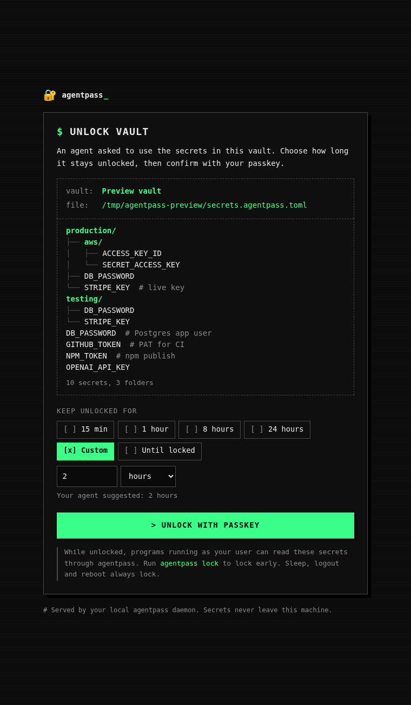
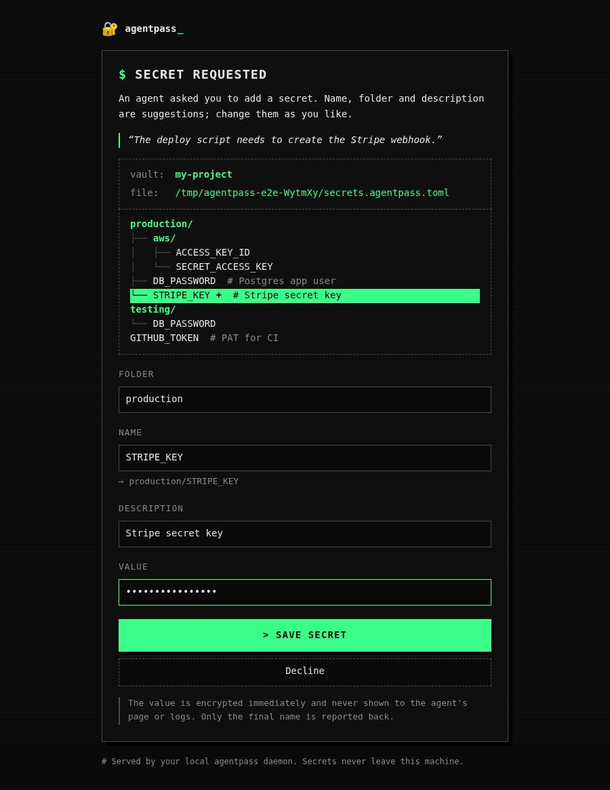
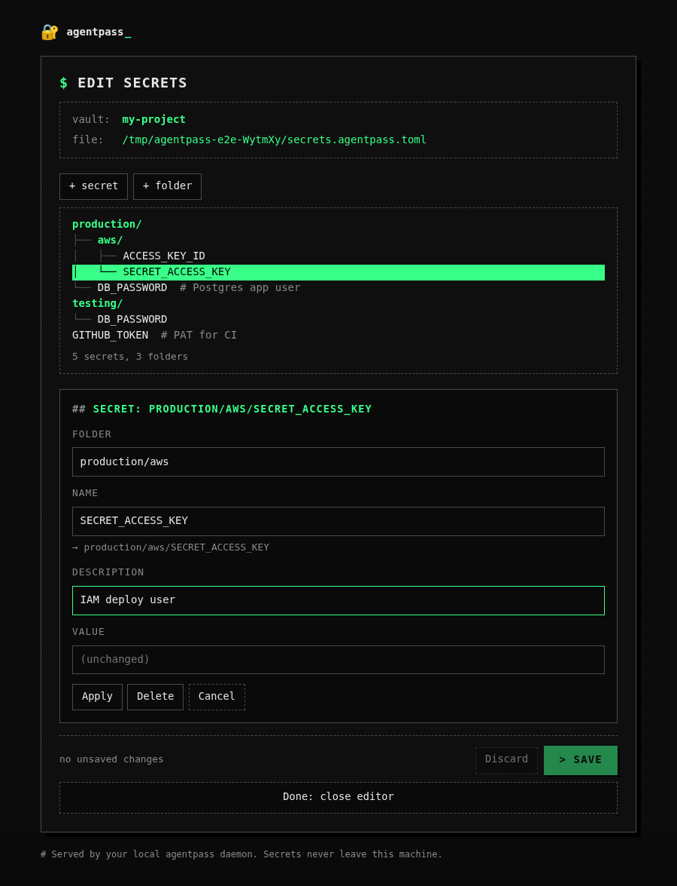

<div align="center">

# 🔐 agentpass

**A password manager for AI agents, unlocked with your passkey.**

[](https://github.com/traumventures/agentpass/actions/workflows/ci.yml)
[](https://github.com/traumventures/agentpass/releases)


</div>

- **Vault in git:** `secrets.agentpass.toml`, names readable, values encrypted.
- **Passkey unlock:** you pick how long (15 min … until locked). Sleep, logout and reboot lock it.
- **Plaintext only in RAM:** agents get values through a pipe or a child's env, never via files.
- **Secrets enter only through your browser:** agents request them, you type them.

```sh
agentpass get GITHUB_TOKEN | gh auth login --with-token
agentpass run -e production/DB_PASSWORD -- ./migrate
```

## Install

```sh
curl -fsSL https://raw.githubusercontent.com/traumventures/agentpass/main/install.sh | sh
# or
cargo install --locked --git https://github.com/traumventures/agentpass agentpass
```

Linux and macOS, x86_64 and arm64.

## Let your agent set it up

Paste this into Claude Code, Codex, Cursor or any coding agent:

```text
Set up agentpass (https://github.com/traumventures/agentpass) for me and show me how it works.

1. If `agentpass --version` fails, install it:
   curl -fsSL https://raw.githubusercontent.com/traumventures/agentpass/main/install.sh | sh
2. Run `agentpass init-skill --all --global --yes` so you know how to use it, then read
   the installed skill (`agentpass skill`) and follow its rules from now on.
3. In this project run `agentpass setup --name "<project name>"`, give me the link,
   then run `agentpass wait <flow id>` while I register a passkey in my browser.
4. Run `agentpass request demo/HELLO -d "Demo secret" --reason "agentpass tour"`,
   give me the link, then `agentpass wait <flow id>`. I'll type a value there. Never ask me to paste a secret into the chat.
5. Run `agentpass unlock --suggest 15m`, give me the link, then `agentpass wait`.
6. Prove you can use the secret without seeing it:
   agentpass run -e HELLO=demo/HELLO -- sh -c 'echo "HELLO has ${#HELLO} characters"'
7. Run `agentpass edit` and give me the link so I can see the editor, then `agentpass lock`.
8. Explain in a few lines what happened, and that secrets.agentpass.toml is safe to commit.
```

## How it looks

| Unlock | Agent requests a secret | Editor |
|---|---|---|
|  |  |  |

## Commands

| Command | |
|---|---|
| `setup [--name N]` | Create `secrets.agentpass.toml`, register a passkey |
| `request KEY [-d DESC] [--reason R]` | Ask the user for a secret (`wait` prints the final name they chose) |
| `edit` | Passkey-protected editor: add, change, rename, delete secrets and folders |
| `list [--json]` | Names and descriptions (works while locked) |
| `unlock [--suggest 1h\|forever]` · `wait` | Print an unlock link · block until unlocked |
| `wait FLOW_ID` | Block until a browser step (setup, request, edit) is done; prints its result |
| `get KEY` | Value to stdout, for piping (refuses a terminal unless `--reveal`) |
| `run -e KEY -e NAME=KEY -- cmd` | Run `cmd` with secrets as env vars |
| `lock [--all]` · `status` | Lock now · show state and time left |
| `name [NEW]` · `passkey add\|list\|remove` | Vault name · backup passkeys |
| `skill` · `init-skill` | Print · install the agent skill (Claude Code, Codex, Cursor, Copilot, Gemini CLI, OpenCode) |

Exit codes: `0` ok · `1` error/declined · `2` usage or several vaults · `3` locked · `4` not found · `5` timeout.

There is deliberately no CLI command that writes a secret.

## Vaults and folders

- Files are named `<name>.agentpass.toml`; `setup` creates `secrets.agentpass.toml`.
- agentpass uses the one in the current directory or the nearest parent. Several in one directory: it lists them; choose with `--file path` (relative) or `AGENTPASS_FILE`.
- `/` in a name makes folders: `production/DB_PASSWORD`, `testing/DB_PASSWORD`. `run -e production/DB_PASSWORD` exports `DB_PASSWORD`.

```toml
version = 1
vault_id = "01K7…"
name = "my-project"
public_key = "base64…"                  # X25519

[[passkeys]]
label = "YubiKey 5C"
credential_id = "base64url…"
prf_salt = "base64url…"
wrapped_private_key = "apw1:…"          # vault key, wrapped by this passkey's PRF output

[secrets."production/DB_PASSWORD"]
description = "Postgres app user"
value = "ap1:…"                         # encrypted to public_key
```

## Security

- **Crypto:** the passkey's WebAuthn **PRF** output → HKDF → unwraps the vault's X25519 key (XChaCha20-Poly1305). Values are sealed to the public key (X25519 + HKDF + ChaCha20-Poly1305), bound to vault id and name.
- **Daemon memory:** the key lives in `mlock`ed, `MADV_DONTDUMP` pages with guard pages, is zeroized on lock/expiry/sleep/logout, no core dumps, `PR_SET_DUMPABLE=0` / `PT_DENY_ATTACH` against same-user `ptrace`.
- **Access:** Unix socket `0600` in a `0700` dir with peer-uid check; web UI on `127.0.0.1` only, `localhost` hosts only, same-origin POSTs, strict CSP, one-time 60-minute link tokens in the URL fragment.
- **Editor:** needs the passkey, but doesn't unlock the vault for agents; existing values are never sent to the page.
- **Tested:** memory scans of the running daemon (key only in a locked no-dump page, gone after `lock`), ptrace/core-dump denial, browser E2E with a virtual PRF authenticator.

**Not covered:** while unlocked, any process of your user can ask for secrets (that's how the agent uses them); root/kernel; what a program does with a value after you pipe it in.

## FAQ

- **Which passkeys?** Any with WebAuthn PRF: YubiKey 5 and other FIDO2 keys, iCloud Keychain, Google Password Manager, 1Password, Bitwarden, in current Chrome, Safari, Firefox or Edge.
- **Remote machine?** `ssh -L 47117:localhost:47117 host`, then open the link locally (any forwarded port works).
- **Lost passkey?** Values can't be recovered. Add a backup: `agentpass passkey add`.
- **Env vars:** `AGENTPASS_FILE`, `AGENTPASS_PORT` (default 47117), `AGENTPASS_RUNTIME_DIR`, `AGENTPASS_IDLE_EXIT_SECS`.

## Development

```sh
rustup target add wasm32-unknown-unknown && cargo install trunk just
just web      # rebuild the Yew UI into crates/agentpass/ui (commit it)
just test     # unit, integration and Playwright E2E
just lint
```

`crates/agentpass` CLI + daemon · `crates/web` Yew UI · `crates/protocol` shared types · `skills/agentpass` agent skill · `e2e` Playwright.

## License

[MIT](LICENSE-MIT) or [Apache-2.0](LICENSE-APACHE), at your option.
